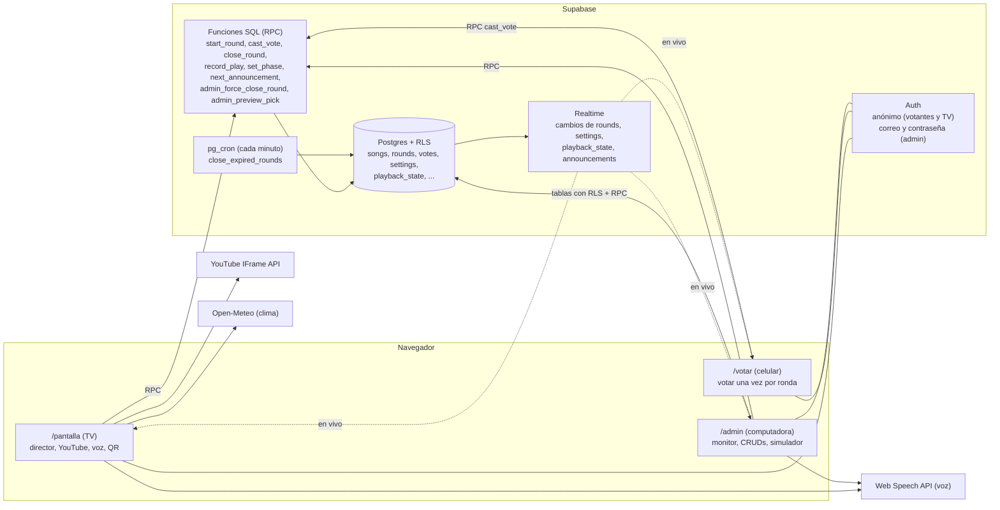
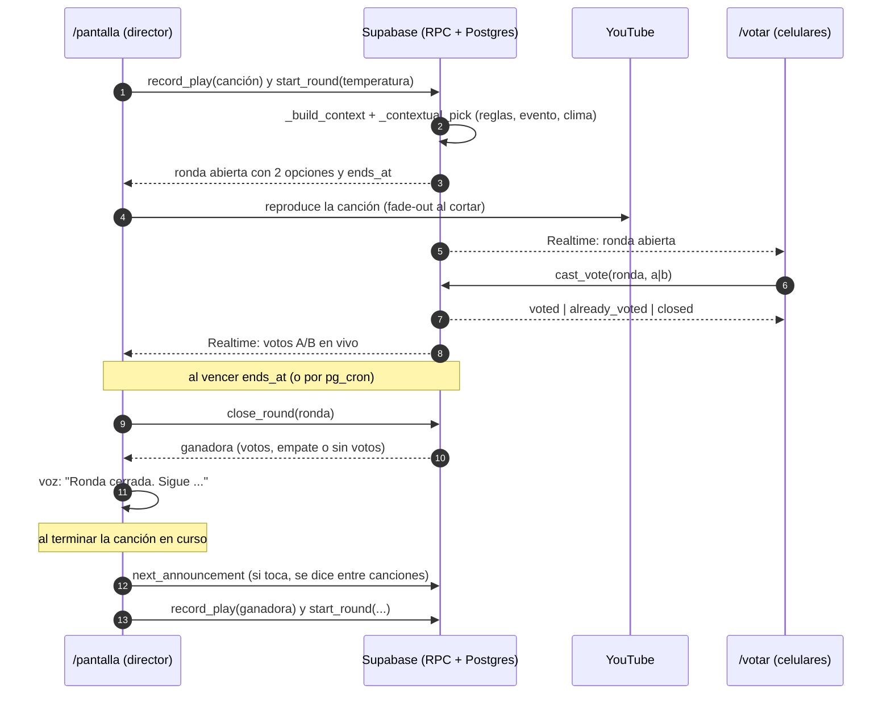
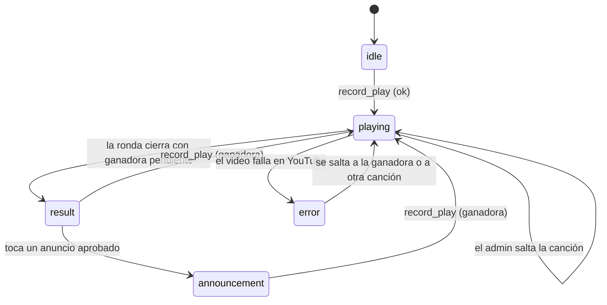
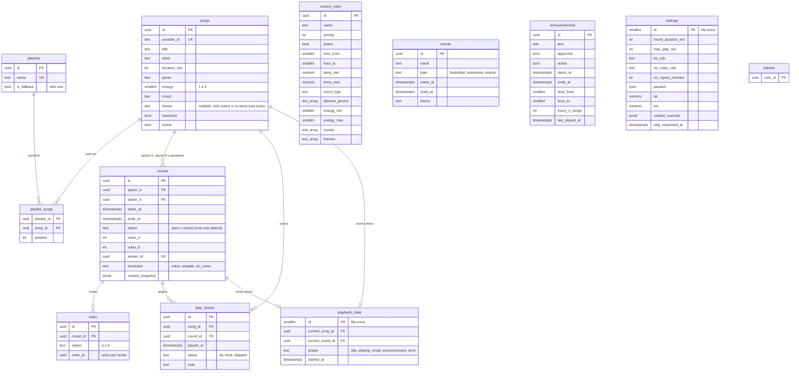

# Arquitectura

Radio Campus es una **SPA de React** sin servidor propio. El navegador habla directo con Supabase (Postgres, Auth, Realtime y funciones SQL) y con tres servicios gratuitos: YouTube (música), Open-Meteo (clima) y la Web Speech API del navegador (voz). **La lógica crítica está en el servidor**, en funciones SQL `security definer`; el cliente solo muestra y pide acciones.

## Vista general



**Reglas de oro del diseño**

- **El servidor manda en los tiempos.** Las pantallas sincronizan un reloj con `server_now()` y cuentan contra él; un celular con la hora mal puesta no cambia nada. Un voto cuenta o no según `now()` del servidor.
- **Seguridad por RLS.** Los visitantes solo leen datos públicos y votan por RPC; nadie escribe directo en `rounds`, `votes` ni `play_history`. Todo lo administrativo exige `is_admin()` (tabla `admins`). Probado en [`supabase/tests/rls_write_access.sql`](../supabase/tests/rls_write_access.sql).
- **Idempotencia.** Cada paso del director se puede repetir sin dañar nada (recargar `/pantalla` retoma la ronda abierta; `start_round` devuelve la ronda abierta si ya existe; solo puede haber una ronda abierta por índice único).
- **Código por capas.** `src/hooks` (lógica, una por página), `src/components` (solo reciben props), `src/lib` (acceso a datos y utilidades puras), `src/types` (tipos con barrel).

## Una ronda, paso a paso



`ends_at = inicio de la canción + min(duración, max_play_sec) − 10 s`, con `round_duration_sec` como mínimo. La ganadora entra cuando termina la canción en curso.

## Fases de `/pantalla`



La fase se guarda en `playback_state.phase` para que `/votar` y el monitor sepan qué suena.

## El algoritmo contextual

`start_round` arma un **contexto** (hora del campus, temperatura, evento vigente) y `_contextual_pick` elige 2 canciones:

1. Aplica las **reglas activas** que cumplen sus condiciones; la de mayor prioridad define géneros y energía, y las demás afinan ánimo y tema.
2. **Filtros duros:** canciones activas, no restringidas, distintas de la que suena y no repetidas dentro de `no_repeat_minutes`. Una canción con `theme` solo es elegible si su tema está activo (evento o regla).
3. **Filtros suaves** (ánimo, tema): solo se aplican si dejan al menos 2 canciones.
4. Elige la primera al azar y la segunda, de preferencia de otro artista.
5. **Sin temperatura o con menos de 2 elegibles** → playlist de respaldo (nunca una ronda vacía).

El simulador de `/admin` permite ver qué ofrecería con otra hora, temperatura o evento (`admin_preview_pick`, solo lectura) y aplicarlo a la radio real (`settings.context_override`). Evidencia: [`docs/evidencias/fase8/`](evidencias/fase8/).

## Base de datos



### Quién puede qué (RLS)

| Quién | Lee | Escribe |
|---|---|---|
| Visitante anónimo (votantes, TV) | canciones activas y no restringidas, eventos, ajustes, rondas, estado de reproducción, anuncios aprobados y activos, **su propio voto** | solo por RPC: `cast_vote`, y desde la TV `start_round`, `close_round`, `record_play`, `set_phase`, `next_announcement` |
| Administrador (`is_admin()`) | además: canciones restringidas, playlists, reglas, historial, todos los anuncios | canciones, playlists, reglas, eventos, anuncios y `settings`; no escribe directo en `votes`, `rounds` ni `play_history` |
| `pg_cron` | — | cierra rondas vencidas cada minuto (`close_expired_rounds`) |

### Migraciones

| Archivo | Qué hace |
|---|---|
| `20261113000100_schema.sql` | Tablas, índices y filas únicas de `settings` y `playback_state` |
| `20261113000200_rls.sql` | Políticas de lectura y escritura, privilegios mínimos, Realtime |
| `20261113000300_round_logic.sql` | `cast_vote`, `close_round`, `start_round`, algoritmo contextual, anuncios, `pg_cron` |
| `20261113000400_theme_eligibility.sql` | Una canción con tema solo es elegible si su tema está activo |
| `20261113000500_distinct_active_themes.sql` | `active_themes` sin duplicados |
| `20261117000100_admin_preview_pick.sql` | `admin_preview_pick` (vista previa de solo lectura para el simulador) |

## Estructura del código

```
src/
  pages/        Pantalla, Votar, Admin, Diagnostico (solo desarrollo): cada una llama a su hook principal
  hooks/        usePantalla, useVotar, useAdmin (+ useAdmin*), useLiveState, useServerClock,
                useYouTubePlayer, useSpeech, useWeather, useAnonymousSession, useAdminSession...
  components/   vistas y piezas que solo reciben props (+ votar.css, pantalla.css, admin.css, radio.css)
  lib/          api.ts (acceso a datos), speech.ts, playback.ts, weather.ts, youtube.ts, time.ts...
  types/        tipos, con index.ts como barrel
  styles/       tokens.css: única fuente de colores, tipografías, espacios, radios y movimiento
supabase/       migraciones, seed y pruebas SQL
docs/           esta documentación y las evidencias
```
